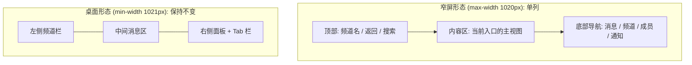
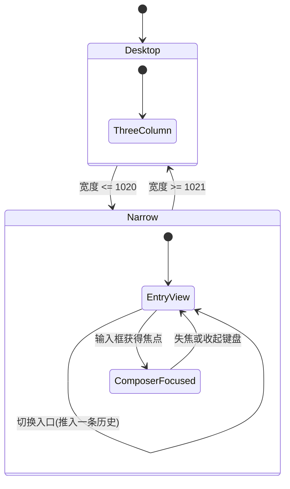
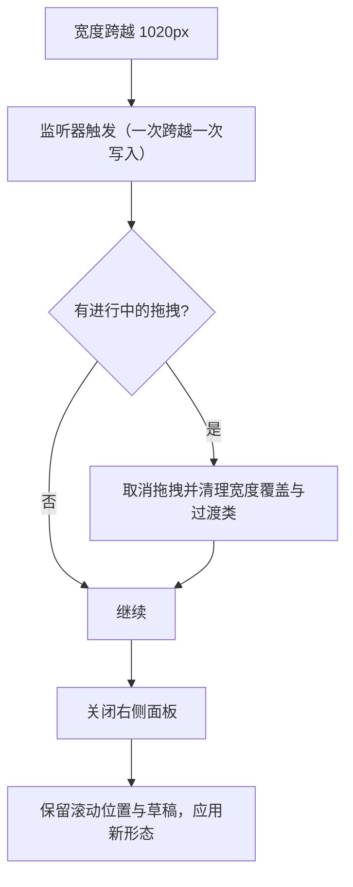

# Mobile Responsive Shell - Plan

## Goal Capsule

- **Objective:** 用手机或窄窗口打开平台的人，能在不横向滚动、不被面板遮挡、输入框不被屏幕键盘吞掉的前提下完成四件事——看与回消息、切频道与找私信、看成员并发起私聊、看通知与提及汇总。窄屏形态覆盖 ≤1020px 的全部窗口，桌面窗口的呈现不发生任何变化。
- **Means:** 在现有外壳上把三栏收敛为单栏，并用底部四个常驻入口承载导航，入口由路由拥有（KTD1, KTD2）。
- **Product authority:** 本次范围由需求方在会话中逐项确认；个人主页、成就工作台、管理后台（`/admin_console`）三个独立全屏路由不在本次范围内。
- **Execution profile:** `code`。
- **Open blockers:** 无。

---

## Product Contract

Product Contract preservation: 含义与 ID 均保留，无重新编号。Problem Frame 的第三处断层依据实现研究作了更正——`/direct_messages` 原诊断指向一份从未生效的样式表，且「通知」入口的原理由（入口被窄屏隐藏）经复核不成立：该视图全仓没有任何 UI 入口。R12–R17 与 AE7–AE12 是规划期间新增的决定；AE10 与 F1 只做了与既有 R15/R7 对齐的自相矛盾修正，未改变其含义。

### Summary

窄屏（≤1020px）下把三栏外壳收敛成单栏，并以底部常驻的 4 个入口承载导航，让四个高频动作在 360px 宽的手机上无需横向滚动、不被遮挡即可完成。入口由路由拥有，输入框聚焦时底部栏让位；≥1021px 的桌面呈现保持逐像素不变。

### Problem Frame

团队此前的判断是「网站没有做手机端适配」。核实后这个前提不成立。上游 Mattermost 的移动骨架是完整的：≤768px 时三栏塌缩为单列，`mobile_view_watcher` 驱动的移动判定为真，并渲染移动端频道头部与汉堡抽屉。真正的断层在自研层与这套上游骨架之间，共三处。

第一处是宽度记账：新加的 44px 右侧 Tab 栏渲染在右侧面板元素内部，而右侧面板的宽度来自一个固定值，没有为这 44px 留出余量，宽度只能从内容里挤，成员名因此被截断到不可辨认。第二处是规则缺失：右侧面板内部的横向排列规则只在 ≥769px 声明，因此在 769px 以下这套排列根本不存在。

第三处是诊断本身。团队把问题归到 `/direct_messages` 的窄屏表现，但该路由的控制器样式表从未被应用到任何元素——它是一段死代码，而该路由的 DOM 形状与可正常工作的频道路由完全一致。真正的问题是「成员」这一视图没有承载它的页面：它只是右侧面板的一个状态，而那个面板在 ≤1020px 正是本次要求禁止的全宽浮层。同一处缺口让「置顶」「文档」以及通知汇总都没有落脚点。

需求方实际观察到的现象发生在 769–1020px 区间：该区间右侧面板是浮层（绝对定位、高层级、靠状态类滑入），因此它会盖在消息列之上，而消息列并不会为它让出宽度。这就是最初被描述为「层级优先级」的问题；已核实该表述在整个工作区零匹配，说明它此前只存在于聊天里。

代价是窄屏用户无法用手机完成日常动作。此外，769–1020px 这一段今天既不是桌面形态也不是窄屏形态——它保留了全部桌面外壳（60px 全局头部、65px 团队栏、44px 应用栏）——而三个外壳的收起规则都停在 768px，本次要把它们与窄屏形态对齐。

### Key Decisions

- **底部常驻入口作为窄屏导航形态。** (session-settled: user-directed — chosen over 单栏+汉堡抽屉 与 三段横滑: 常驻入口让四个高频动作各只需一次点击，而抽屉与手势都要求先记住入口在哪) Governs R2, R3.
- **窄屏形态的上界取 1020px，且 ≤1020px 一并收掉桌面外壳。** (session-settled: user-directed — chosen over 900px 与「保留桌面外壳只做单列」: 取消平板中间态，行为单一可预测；已接受 900–1020px 的笔记本窄窗口同样得到完整窄屏形态的代价) Governs R1, R8, R13.
- **分两步交付：先收敛单栏并统一断点，再替换导航骨架。** (session-settled: user-approved — 在「新建独立窄屏外壳」与「改造现有外壳」之间，先以最低爆炸半径验证单栏是否稳定) Governs R1, R9.
- **验收标准停在桌面零回归，不覆盖三个独立全屏路由。** (session-settled: user-directed — chosen over 一并覆盖个人主页/成就工作台/管理后台: 先锁定外壳这一层的风险，路由另立条目) Governs R9.
- **窄屏生效宽度与运行时窗口判定必须同源。** 两条阈值分离会产生「样式已是窄屏、组件仍走桌面分支」的错配，这类 bug 的定位成本远高于阈值本身的对齐成本。 Governs R8.
- **「置顶」与「文档」并入成员视图的二级分段。** (session-settled: user-directed — chosen over 独立底部入口 / 顶部频道菜单 / 本轮不做: 不占用稀缺的底部槽位，也不必引入新的导航概念) Governs R7.
- **截图中的窄屏成员层级问题并入本次范围。** (session-settled: user-directed — chosen over 另立独立条目 / 先复现再定: 阈值上移到 1020px 后该现象正落在本次改动面上) Governs R11.
- **底部入口由路由拥有，选中态由路由推导。** (session-settled: user-directed — chosen over 纯状态切换 与 混合: 返回键、刷新与深链在手机上都是真实需求，仓库已有 `/direct_messages`、`/team/threads`、`/team/recaps` 先例) Governs R14, R15.
- **第四个入口复用现有的提及视图。** (session-settled: user-directed — chosen over 新建聚合页 与 复用线程列表: 该视图已存在且自带空态，而全仓没有任何 UI 入口能到达它——触发动作只被右侧面板的返回逻辑调用——手机用户根本进不去) Governs R2, R16.
- **输入框聚焦时底部导航让位。** (session-settled: user-directed — chosen over 底部栏随键盘上移 与 保持固定在键盘之下: 360px 宽度下垂直空间已很紧，让位同时保住输入框可见与内容不被遮挡) Governs R12.

### Actors

- A1. 窄屏使用者——用手机竖屏或窄窗口打开平台的人，本次行为的直接受益者。
- A2. 桌面使用者——窗口 ≥1021px，本次体验必须逐像素不变。

### Requirements

**窄屏外壳形态**

- R1. 窗口宽度 ≤1020px 时，应用以单列形态呈现，不同时并排显示左侧频道栏与右侧面板。
- R2. 窄屏形态下，导航由底部常驻的 4 个入口承载：消息、频道、成员、通知与提及汇总。
- R3. 每个底部入口点击一次即到达其主视图，且当前所在入口有可见的选中态。
- R4. 窄屏形态在 360px 宽竖屏下不出现横向滚动，且任何内容不被其他面板遮挡。
- R5. 消息输入框在窄屏形态下始终可见可用，不被底部导航遮挡。

**成员与同级视图**

- R6. 窄屏下成员列表是可达的独立视图，成员行完整可读，不被截断到无法辨认。
- R7. 窄屏下「置顶」与「文档」作为「成员」入口内的二级分段，与成员列表同级切换。

**断点与判定一致**

- R8. 窄屏形态的生效宽度与运行时窗口判定使用同一阈值；在 1020px 两侧切换时不出现「样式已切换、组件仍按桌面分支渲染」的组合。
- R9. 窗口 ≥1021px 的桌面呈现与改动前逐像素一致，包括三栏、全局头部、右侧 Tab 栏与成员面板。

**自研私信路由**

- R10. `/direct_messages` 在窄屏下以单列呈现，其自研侧栏与中间区不同时可见并互相覆盖。

**窄屏成员列表的层级**

- R11. 窄屏下成员列表不出现面板叠加或层级错乱：成员列表与其所在容器的其他面板不同时可见并互相覆盖。

**键盘与可达性**

- R12. 窄屏下输入框获得焦点、屏幕键盘弹出时，底部导航让位，输入框及其发送控件保持完全可见可用。
- R13. 窗口 ≤1020px 时桌面外壳（全局头部、团队栏、应用栏）不渲染；团队切换在窄屏下仍有可达入口。

**入口与位置**

- R14. 每个底部入口对应一个可链接的位置：浏览器返回键在访问过的入口之间回退，刷新后停留在同一入口，链接可直达该入口。
- R15. 在没有任何底部入口对应的路由（插件页、产品页、个人主页、成就工作台）上，四个入口均不显示选中态；底部栏只在壳内路由上渲染。
- R16. 「通知」入口显示当前用户的提及计数，数值来源与桌面端一致；没有提及时不显示计数。

**抽屉对导航的让位**

- R17. 窄屏下左侧抽屉打开时，底部导航让位且入口不可点击，抽屉关闭后恢复。

### Key Flows

- F1. 窄屏下从消息切到成员并发起私聊
  - **Trigger:** A1 停留在窄屏形态的消息视图。
  - **Actors:** A1
  - **Steps:** 点击底部「成员」→ 成员视图成为当前位置且该入口显示选中态 → 点击目标成员所在整行 → 进入与该成员的私信视图。
  - **Outcome:** 从消息到达与目标成员的私信，共 2 次点击；返回键回到成员视图。
  - **Covered by:** R2, R3, R6, R14
- F2. 窄屏下切换频道
  - **Trigger:** A1 停留在窄屏形态的任意视图。
  - **Actors:** A1
  - **Steps:** 点击底部「频道」→ 频道列表成为当前视图 → 选择目标频道 → 回到该频道的消息视图。
  - **Outcome:** 一次点击进入频道列表，再一次进入目标频道。
  - **Covered by:** R2, R3
- F3. 窄屏下回复消息时键盘弹出
  - **Trigger:** A1 在窄屏消息视图点击输入框。
  - **Actors:** A1
  - **Steps:** 输入框获得焦点 → 底部导航让位 → 键盘弹出，输入框与发送控件完整可见 → 收起键盘或失焦 → 底部导航恢复。
  - **Outcome:** 输入过程中没有任何导航元素遮挡输入框，输入结束后导航回到原位。
  - **Covered by:** R12, R5

### Acceptance Examples

- AE1. 360px 竖屏无横向滚动
  - **Covers R1, R4, R5.**
  - **Given:** 浏览器窗口宽 360px，已登录。
  - **When:** 打开任一频道的消息视图并滚动到最新消息。
  - **Then:** 不出现横向滚动；底部 4 个入口全部可见且高度不挤压消息区；消息正文与输入框均不被遮挡。
- AE2. 缩窄到断点时的形态切换
  - **Covers R8, R13.**
  - **Given:** 窗口宽 1021px，三栏形态与桌面外壳可见。
  - **When:** 将窗口缩窄到 1020px。
  - **Then:** 立即切换为单列加底部 4 入口，全局头部、团队栏与应用栏都不再渲染，且不出现「布局已切换但组件仍按桌面渲染」的错配。
- AE3. 放大回桌面区间时恢复原状
  - **Covers R9.**
  - **Given:** 窗口已处于窄屏形态（宽 1020px）。
  - **When:** 将窗口放大到 1021px。
  - **Then:** 恢复三栏与全部桌面外壳，渲染与改动前一致，无残留的窄屏样式。
- AE4. 自研私信路由的窄屏形态
  - **Covers R10.**
  - **Given:** 窗口宽 360px。
  - **When:** 打开 `/direct_messages`。
  - **Then:** 一次只呈现侧栏或中间区之一，不出现两者叠加；可从当前视图切换到另一个。
- AE5. 窄屏成员列表不被覆盖
  - **Covers R6, R11.**
  - **Given:** 窗口宽 360px，所在频道有多名成员且含管理员分组。
  - **When:** 从底部进入「成员」并滚动整个列表。
  - **Then:** 成员行完整可读；没有任何面板覆盖在列表之上，也不出现层级错乱。
- AE6. 成员入口内二级分段的往返
  - **Covers R7.**
  - **Given:** 窗口宽 360px，已进入底部「成员」入口。
  - **When:** 切到「置顶」或「文档」分段，再切回「成员」。
  - **Then:** 每次切换都到达对应视图；切回后成员列表完整可见，无残留的覆盖层。
- AE7. 输入框聚焦时底部导航让位
  - **Covers R12.**
  - **Given:** 窗口宽 360px，处于窄屏消息视图。
  - **When:** 点击输入框使屏幕键盘弹出。
  - **Then:** 底部导航不再占据输入框下方的空间，输入框与发送控件完整可见可点；收起键盘后底部导航恢复。
- AE8. 窄屏下的团队切换
  - **Covers R13.**
  - **Given:** 窗口宽 900px，账号属于多个团队。
  - **When:** 进入底部「频道」入口并使用其中提供的团队切换。
  - **Then:** 可切换到另一个团队；切换后仍停留在窄屏形态，底部栏不变。
- AE9. 入口位置可链接、可刷新、可回退
  - **Covers R14.**
  - **Given:** 窗口宽 360px，已从消息视图依次进入「成员」与「通知」。
  - **When:** 依次按浏览器返回键；随后直接刷新页面；随后用该地址在新标签打开。
  - **Then:** 每次返回都回到上一个访问过的入口并更新选中态；刷新后停留在同一入口；新标签直达该入口。
- AE10. 没有入口对应的路由
  - **Covers R15.**
  - **Given:** 窗口宽 360px，停在一个插件路由上。
  - **When:** 观察底部栏与选中态。
  - **Then:** 底部栏保持渲染，四个入口均无选中态；从该路由返回有入口对应的路由后，选中态恢复。
- AE11. 通知入口的提及计数
  - **Covers R16.**
  - **Given:** 窗口宽 360px，当前账号有未读提及。
  - **When:** 观察底部「通知」入口。
  - **Then:** 该入口显示提及计数，且与桌面端角标数值一致；读完全部提及后计数消失。
- AE12. 抽屉打开时底部导航让位
  - **Covers R17, R4.**
  - **Given:** 窗口宽 900px，处于窄屏形态。
  - **When:** 打开左侧抽屉。
  - **Then:** 底部导航让位且入口不可点击，二者不互相压盖；关闭抽屉后底部导航恢复。

### Visualizations

窄屏与桌面两种区域构成：

### Success Criteria

- 四个高频动作在 360px 竖屏下各自可在 3 次点击内完成，且全程无横向滚动。
- 窗口 ≥1021px 的渲染与该改动前的基线截图逐像素一致。
- 在 360px 竖屏、输入框聚焦的状态下，消息正文与输入框都完整可见。

### Scope Boundaries

**Deferred for later**

- `/u/:username` 个人主页与编辑器、`/iuin_honors_admin` 成就工作台、管理后台的窄屏适配。三者是独立于频道外壳的全屏路由，不共享外壳，留待外壳稳定后单独立项。

**Deferred to Follow-Up Work**

- 把散落在组件自有样式里的字面断点迁移到统一的断点 mixin。仓库里约有 60 处字面断点分布在 40 个样式文件中，其中绝大多数属于弹窗、预览与菜单的内部排版，与外壳边界无关；`webapp/STYLE_GUIDE.md` 已把这项迁移列在「仍待完善」下，本次不动。
- 保住管理员的「getting started」任务列表在 900–1020px 下的可见性。该列表当前以移动判定为条件隐藏，阈值上移后会在窄屏形态中一并消失——与 ≤768px 的现有行为一致，但属于窄屏形态内的功能减少，如需保留需单独决定其在小屏上的呈现方式。

**Outside this product's identity**

- 原生 App 与 PWA / 离线 / 推送。仓库内不存在 React Native 客户端，`webapp/platform` 只含共享 TypeScript 包；service worker 是被主动注销的，也没有 PWA web-app manifest。这是另一条产品线，不是本次适配的延后项。

<!-- ce-section: work-relationships -->

### How This Work Fits Together

本计划只覆盖频道外壳这一层。以下拆分是当前的理解，不是已承诺的路线图。

- 窄屏外壳适配（本计划）
  - Enables 个人主页与资料编辑器的窄屏适配——它们虽是独立全屏路由，但复用同一套断点与窗口判定，本计划统一阈值后才有稳定的对齐基准。
  - Can proceed independently of 成就工作台与管理后台的窄屏适配——两者自带断点阶梯，不依赖外壳形态。
  - Shares 断点定义与窗口判定 与 所有后续窄屏工作——R8 是共享前提。

### Dependencies / Assumptions

- **假设（未经真机复现）：** 需求方截图中的现象发生在 769–1020px 区间，由右侧面板的浮层行为与 44px Tab 栏的宽度记账共同造成。该结论来自代码核实与截图比对，尚未在真实手机上验证。
- **假设：** 真实手机（≤768px）当前不会进入桌面布局。仓库内的视口声明正确（`width=device-width, initial-scale=1.0`），因此除非设备启用桌面模式，窄屏形态会在真机上生效。
- **依赖：** 本计划依赖上游移动骨架保持可用——`mobile_view_watcher` 的无条件挂载与 `sass/base/_structure.scss` 的塌缩分支。若上游后续重构该骨架，本计划需重新评估。
- **依赖：** 仓库内不存在读取视觉视口的代码，键盘让位所需的机制需新建，没有本地先例可复制；因此 R12 与 R17 的最终行为只能在真机上确认，单元测试只能覆盖判定逻辑。

### Sources / Research

- `webapp/channels/src/sass/responsive/_mobile.scss` — 上游窄屏媒体查询入口（第 5 行起，覆盖整个文件），以及右侧面板在该区间变为全宽滑入面板（约 1372–1375 行）。
- `webapp/channels/src/sass/base/_structure.scss` — 三栏塌缩为单列（244–285 行）；`#channel_view`、`#SidebarContainer`、`.product-wrapper`、`#sidebar-right` 被置于同一网格单元（271–277 行）。
- `webapp/channels/src/sass/responsive/_tablet.scss` — 769–1020px 区间右侧面板的浮层行为（412–432 行），需求方截图现象的出处。
- `webapp/channels/src/sass/layout/_sidebar-right.scss` — 右侧面板宽度的取值来源（14、18 行，`--overrideRhsWidth` 在此被消费，实际由 `components/resizable_sidebar/` 声明与设置）；面板内部的横向排列规则仅在 `min-width: 769px` 生效（316–334 行）。
- `webapp/channels/src/components/sidebar_right/sidebar_right.tsx` — 44px Tab 栏渲染在右侧面板元素内部（320–351 行）。
- `webapp/channels/src/components/rhs_tab_bar/rhs_tab_bar.tsx` — 三个 Tab 的 `rhsState` 为 `CHANNEL_MEMBERS` / `PIN` / `CHANNEL_FILES`（30–52 行），即成员入口二级分段要承载的三项。
- `webapp/channels/src/components/direct_messages_controller/` — 控制器样式表定义了一个从未被应用到的类，同目录测试断言该类不存在；控制器与侧栏样式零媒体查询。
- `webapp/channels/src/utils/constants.tsx` — 桌面 / 平板 / 移动三个宽度阈值（1548–1550 行）与独立的侧栏尺寸阈值 `SMALL_SIDEBAR_BREAKPOINT: 900`（1552 行）；两套阶梯互不相关。
- `webapp/channels/src/components/root/root.tsx` — 窗口监听挂载于 317 行；个人主页与成就工作台在 `.main-wrapper` 之外（417–448 行）；`.main-wrapper` 自 467 行开始；`/direct_messages` 在其内（528–531 行）；`<SidebarRight/>` 在 538 行。
- `webapp/channels/src/components/global_header/global_header.tsx` 与 `webapp/channels/src/components/app_bar/app_bar.scss` — 各在 ≤768px 被隐藏（29–31 行 / 11–13 行）。
- `webapp/channels/src/sass/layout/_team-sidebar.scss` 与 `webapp/channels/src/sass/responsive/_mobile.scss` — 团队栏宽 65px（1–5 行），仅在 ≤768px 隐藏（约 1532–1533 行）。
- `webapp/channels/src/components/widgets/menu/` 与 `webapp/channels/src/components/resizable_sidebar/resizable_divider.tsx` — 分别以移动判定切换到移动弹窗行为、以及返回空值使拖拽分隔条消失。
- `webapp/channels/src/components/search_results/messages_or_files_selector.tsx` — 仓库内手写的分段控件先例（`role='tablist'`、`aria-selected`、roving tabIndex、方向键处理），成员入口的二级分段应镜像它。
- `webapp/channels/src/components/no_results_indicator/no_results_indicator.tsx` — 提及视图的空态文案（56–57 行）。
- `webapp/channels/src/components/mobile_view_watcher/mobile_view_watcher.tsx` — 四个 `matchMedia` 查询全部只监听宽度（13–16 行），且在 change 事件上无防抖（34–44 行）。
- `webapp/channels/src/components/admin_console/admin_sidebar/index.ts` — 管理员任务列表以移动判定为隐藏条件（34–35 行）；`admin_console.tsx` 通过 `console__root` 使控制台本身免受塌缩影响。
- 团队自研文档 `开发文档/lzx-sidebar-right-tab-bar.md` — 44px Tab 栏的引入方式与其外层容器的 flex 排列说明。
- 团队自研文档 `开发文档/提交开发文档/02-f0c35d4882-shell-navigation-branding.md` 与 `03-af2fe743f0-landing-shell-styles.md` — 顶部导航、产品菜单、站点名与基础样式变量已改为平台自身表达，窄屏改动不得波及这些品牌入口与变量。
- `e2e-tests/playwright/specs/functional/channels/search/mobile_rhs_focus.spec.ts` — 仓库内唯一以 400×1024 视口驱动的窄屏用例；`e2e-tests/playwright/playwright.config.ts` — 默认视口 1280×1024 与 `ipad` project。
- `webapp/channels/src/sass/layout/_sidebar-right.scss:20-37` — 右侧面板的宽度上限只对 ≥901px 生效，特异性高于窄屏样式块里的宽度声明，是 901–1020px 面板不会全宽的原因。
- `webapp/channels/src/actions/views/rhs.ts:468` — 提及动作同时派发搜索与切换右侧面板状态，是纯状态动作、不含任何路由写入；全仓没有 UI 调用点。
- `webapp/channels/src/components/advanced_text_editor/use_textbox_focus.tsx:42-44,89-92,100-106` — 频道变化与首次挂载都会程序化聚焦输入框，且仅在移动 UA 下跳过，因此窄窗口会触发。
- `webapp/channels/src/components/channel_members_rhs/member.tsx:49` 与 `channel_members_rhs.scss:53-58,156-157` — 直接开私信的分支以频道类型为条件，而发送按钮默认 `display: none`、仅悬停时可见。
- 团队自研文档 `开发文档/提交开发文档/14-9cfc73dcb0-profile-global-header.md` — 个人主页保留全局头部的既有修复；失去它会让用户难以回到平台其它区域，本次不得回归。
- `webapp/channels/src/root.html:6` — 视口声明没有 `viewport-fit=cover`，安全区内边距在该声明下恒为 0。

---

## Planning Contract

### Key Technical Decisions

- KTD1. **单一移动判定，不拆分概念。** `MOBILE_SCREEN_WIDTH` 上移到 1020，`getIsMobileView` 的语义随之覆盖 ≤1020；不新增第二个"窄外壳"判定。理由是与需求方选定的「≤1020px 完全等同手机形态」一致，且避免两套半移动状态。 (session-settled: user-directed — chosen over 新增一个只描述窄外壳的判定: 与已确认的 <1020 形态定义一致) Governs R1, R8, R13.
- KTD2. **底部入口由路由拥有，且定义在团队/频道路由树内。** 四个入口各自是一条路由，注册在频道控制器的兜底重定向前面；成员与通知入口的地址携带频道标识，否则刷新与直达时团队和频道上下文从未初始化，只会渲染加载态。不引入"当前入口"这一新的 Redux 状态。 Governs R14, R15.
- KTD3. **阈值统一只覆盖外壳边界。** 外壳相关的字面断点全部对齐到同一阈值；组件自有样式里的字面断点保持不动，整仓断点 mixin 迁移进入 `Deferred to Follow-Up Work`。 Governs R8.
- KTD4. **让位以视觉视口被压缩为准，焦点只作进入条件。** 宽度监听不响应键盘；而焦点单独不够——窄窗口下切换频道会程序化聚焦输入框（键盘并不弹出），Android 上系统收起键盘又可能不派发失焦，两个方向都会让底部栏错误消失或永不恢复。因此让位条件是「输入框聚焦 且 视觉视口高度被压缩」。 Governs R12, R17.
- KTD5. **跨阈值清理契约。** 越过阈值时取消进行中的拖拽、清理命令式残留（`layout-changing` 类与 `--overrideRhsWidth`）、关闭右侧面板、保留频道与消息列表滚动位置及草稿。 Governs R9.
- KTD6. **成员视图换承载而非复用浮层。** 保留既有的成员 / 置顶 / 文档状态语义，但由路由承载其呈现；那段从未生效的控制器样式表删除而不是改造。 Governs R7, R10, R11.
- KTD7. **团队切换落在第一步就已存在的承载上。** 团队栏在 ≤1020px 收掉后必须有替代入口，而底部栏与「频道」入口要到第二步才建立；因此第一步把团队切换挂到左侧栏头部（与既有团队菜单同处，复用团队按钮列表），第二步再迁到「频道」入口头部。 Governs R13.
- KTD8. **窄屏下右侧面板不渲染成员/置顶/文档三个分支。** 该面板由右侧状态驱动且无条件挂载；若不摘除这三个分支，同一份成员列表会被路由视图与浮层渲染两次，浮层还会盖住底部栏。 Governs R7, R11.

### High-Level Technical Design

外壳形态是一个由窗口宽度驱动的两态机，入口位置是一个叠加其上的正交维度：

越过阈值时需要清理的顺序（命令式残留先于重排）：

### Phased Delivery

**第一步**（U1–U5）收敛单栏并统一阈值。完成时窄屏形态已是单列，桌面外壳在 ≤1020px 不渲染，跨阈值无残留，团队切换已挂在第一步就存在的承载上；此时导航仍沿用上游的抽屉与滑入形态，可独立验收与发布。

**第二步**（U6–U8）在已稳定的单栏形态上替换导航骨架，加入底部入口、成员入口内的二级分段与键盘让位。

### Assumptions

- 新入口的具体路径段命名不进入用户可见的品牌措辞，由实现期确定；入口必须落在团队/频道路由树内，且成员与通知的地址携带频道标识（KTD2）。
- 通知入口指向既有的提及视图：该视图由右侧面板状态驱动，全仓没有任何 UI 入口能到达它；入口须是一条携带频道上下文的路由，挂载时触发同一动作并抑制右侧面板同时打开，离开路由时关闭面板。
- 视觉视口驱动的高度预算是新机制，具体实现方式（监听事件还是布局属性）由实现期在真机上验证后确定。
- 窄屏下不保留左侧抽屉与底部栏同时可见的形态：抽屉打开时底部栏让位（R17）。这一取舍使抽屉的全宽处理保持上游原样。
- 插件路由与产品路由的窄屏呈现沿用上游行为，本次不为其新增入口。

---

## Implementation Units

### U1. 断点单一来源

- **Goal:** 让窄屏的生效宽度与运行时窗口判定由同一个阈值决定，并让外壳相关样式全部引用该阈值对应的断点。
- **Requirements:** R8, R1
- **Dependencies:** 无
- **Files:** `webapp/channels/src/utils/constants.tsx`, `webapp/channels/src/sass/responsive/_mobile.scss`, `webapp/channels/src/sass/responsive/_tablet.scss`, `webapp/channels/src/sass/base/_structure.scss`, `webapp/channels/src/sass/layout/_sidebar-left.scss`, `webapp/channels/src/sass/layout/_sidebar-right.scss`, `webapp/channels/src/sass/layout/_team-sidebar.scss`, `webapp/channels/src/components/app_bar/app_bar.scss`, `webapp/channels/src/components/global_header/global_header.tsx`, `webapp/channels/src/components/mobile_view_watcher/mobile_view_watcher.test.tsx`
- **Approach:**
  1. 把移动阈值从 768 改为 1020，桌面/平板阈值保持不动；平板值随之与移动值相等，平板视图分支自此不可达，需确认无组件依赖两者不等。
  2. 把外壳相关的字面断点对齐到新阈值——全局布局塌缩、窄屏样式块入口、右侧面板浮层块、团队栏与应用栏的隐藏、全局头部的隐藏。仅限外壳边界，组件自有样式不动（KTD3）。
  3. 处理两个直接读同一常量、不经移动判定的消费点（通知条文案与 toast 的跳转提示），确认它们在 769–1020px 的新行为可以接受；若不接受，让它们改用独立的显示判定，而不是绑定移动阈值。
  4. 核对样式层叠顺序：窄屏样式块与平板样式块在 769–1020px 会同时命中，后者在源码中靠后，同特异性时以它为准；逐条确认其中的紧凑排版规则在该区间是否需要保留。
  5. 不引入断点 mixin；本次是阈值对齐，不是断点体系重构。
- **Patterns to follow:** 现有 `sass/responsive/` 三个文件按 768 / 769 / 1020 划分的组织方式；`mobile_view_watcher` 已经以常量构造查询，因此其测试对新阈值天然免疫。
- **Test scenarios:**
  - 移动判定在 1020px 为真、在 1021px 为假。
  - 移动判定在 360px 与 768px 同样为真（阈值上移不改变小屏行为）。
  - `mobile_view_watcher` 在跨越 1020px 时派发移动视图状态，跨越 1021px 时派发桌面视图状态。
  - 窄屏样式块与运行时判定使用同一数值（以常量构造断言，避免字面量重复）。
- **Verification:** 单元测试通过；在 1020px 与 1021px 各加载一次，确认样式切换与组件分支同时发生，不出现单侧切换。

### U2. 窄屏外壳构成

- **Goal:** ≤1020px 时应用呈现为单列，且桌面外壳（全局头部、团队栏、应用栏）不渲染。
- **Requirements:** R1, R13, R4
- **Dependencies:** U1
- **Files:** `webapp/channels/src/sass/base/_structure.scss`, `webapp/channels/src/sass/responsive/_mobile.scss`, `webapp/channels/src/sass/layout/_team-sidebar.scss`, `webapp/channels/src/components/app_bar/app_bar.scss`, `webapp/channels/src/components/global_header/global_header.tsx`, `webapp/channels/src/components/team_sidebar/`
- **Approach:**
  1. 把塌缩分支的生效宽度与新阈值对齐，确认网格退化为单一区域。
  2. 把团队栏与应用栏的隐藏规则上移，使二者的收起位置与塌缩分支一致，否则会出现底部导航叠在桌面外壳之下。
  3. 全局头部的隐藏规则只作用于壳内树——挂在承载外壳的根节点选择器上，而不是该组件自身的媒体查询。该组件在个人主页的路由树内也被渲染，规则挂在组件上会在 769–1020px 一并关掉该页面唯一的平台导航，而 Scope Boundaries 已把该路由列为本次不动的延后项。
  4. 团队切换先挂到左侧栏头部（与既有团队菜单同处，复用团队按钮列表），使第一步交付后窄屏仍有团队切换入口；第二步由 U6 把它迁到「频道」入口头部（KTD7）。
  5. 品牌相关的样式变量与品牌入口不改动，仅改变它们的显示条件。
- **Patterns to follow:** 现有塌缩分支的结构；`team_sidebar` 的既有团队选择入口。
- **Test scenarios:**
  - 900px 宽时全局头部、团队栏、应用栏在壳内路由上均不渲染。
  - 900px 宽时个人主页仍渲染全局头部（该路由不在本次范围内，不得回归）。
  - 1021px 宽时三者全部渲染，且与改动前一致。
  - 900px 宽时团队切换可达，切换后仍为窄屏形态。
  - 360px 宽时行为与改动前一致（回归保护）。
- **Verification:** 900px 与 1021px 各加载一次，确认外壳构成符合预期且无重叠；桌面宽度下三项外壳元素的位置与尺寸与改动前一致。

### U3. 窄屏抽屉与右侧面板

- **Goal:** 在 769–1020px 这一段，左侧抽屉与右侧面板获得与 ≤768px 等价的规则，不出现"组件按移动分支渲染但样式缺失"。
- **Requirements:** R1, R4, R10, R17
- **Dependencies:** U1, U2
- **Files:** `webapp/channels/src/sass/responsive/_mobile.scss`, `webapp/channels/src/sass/layout/_sidebar-right.scss`, `webapp/channels/src/sass/layout/_sidebar-left.scss`, `webapp/channels/src/components/direct_messages_controller/`
- **Approach:**
  1. 左侧抽屉的宽度与位移规则、右侧面板的全宽滑入规则，其生效范围都要覆盖到新阈值；当前这些规则都在旧阈值的样式块内。
  2. 右侧面板内部的横向排列规则当前只在桌面侧生效，窄屏需要明确其窄屏形态。窄屏下面板内不渲染 44px Tab 栏，也不渲染成员/置顶/文档三个分支（KTD8）——这三项在窄屏只经「成员」入口的二级分段到达。
  3. 面板宽度：桌面侧有一条只对 ≥901px 生效的宽度上限，其特异性高于窄屏样式块里的宽度声明；须把该上限收进桌面区间，否则 901–1020px 面板仍只有固定宽度，消息列会露在旁边。
  4. 删除那段从未被应用到的控制器样式表；私信路由的窄屏形态与其相邻的频道路由保持一致。
- **Patterns to follow:** 上游移动端抽屉的位移与宽度处理；同目录下频道路由的控制器作为私信路由的对齐基准。
- **Test scenarios:**
  - 900px 宽时打开左侧抽屉，抽屉以抽屉形态覆盖内容而非占据网格列。
  - 900px 宽时右侧面板以覆盖形态出现，不与消息列并排，且其内容不被 44px 元素挤压。
  - 1020px 宽时右侧面板为全宽覆盖，消息列不露出；面板内不出现成员/置顶/文档三个分段入口。
  - 900px 宽时从频道信息按钮打开右侧面板，面板内不再出现这三个分支。
  - 360px 宽时打开私信路由，侧栏与中间区不同时可见。
  - 私信路由在 900px 宽时的呈现与相邻的频道路由一致。
- **Verification:** 900px 与 360px 下逐项核对抽屉、右侧面板、私信路由三者的呈现，无横向溢出、无内容被裁切。

### U4. 跨阈值清理

- **Goal:** 窗口跨越阈值时不残留命令式状态，且用户的位置不丢失。
- **Requirements:** R9, R1
- **Dependencies:** U1
- **Files:** `webapp/channels/src/components/mobile_view_watcher/mobile_view_watcher.tsx`, `webapp/channels/src/components/mobile_view_watcher/mobile_view_watcher.test.tsx`, `webapp/channels/src/components/resizable_sidebar/`
- **Approach:**
  1. 一次跨越只产生一次状态写入（四个媒体查询区间互不重叠，且只在匹配时写入），因此不要引入防抖——防抖会把外壳切换推迟一个窗口，与「立即切换」的验收冲突。
  2. 跨越时取消进行中的拖拽，并清理拖拽期间写入的命令式残留（过渡类与宽度覆盖），否则它们会在元素卸载后继续存在。
  3. 跨越时关闭右侧面板；保留频道与消息列表的滚动位置与草稿。
- **Patterns to follow:** 现有拖拽结束路径的清理逻辑；滚动位置与草稿已是持久化状态，直接复用。
- **Test scenarios:**
  - 拖拽进行中跨越阈值：拖拽终止，过渡类与宽度覆盖均被清除。
  - 跨越后回到桌面区间：右侧面板宽度取默认值而非拖拽中断时的值。
  - 连续跨越（1021→1020→1021）不产生重复的清理动作或状态写入。
  - 跨越后频道滚动位置与草稿保留。
- **Verification:** 单元测试覆盖拖拽中跨越与连续跨越；手动在拖拽中缩放窗口，确认无残留且回到桌面后布局正常。

### U5. 私信路由与既有移动组件的窄屏一致性

- **Goal:** 把 `getIsMobileView` 语义扩大到 ≤1020 后，所有会因此切换到移动分支的既有组件在 769–1020px 下都有匹配的样式与行为。
- **Requirements:** R1, R5, R9, R10
- **Dependencies:** U1, U3
- **Files:** `webapp/channels/src/components/sidebar/sidebar.tsx`, `webapp/channels/src/components/channel_layout/channel_controller.tsx`, `webapp/channels/src/components/widgets/menu/`, `webapp/channels/src/components/resizable_sidebar/resizable_divider.tsx`, `webapp/channels/src/components/post/post_options.tsx`, `webapp/channels/src/components/search/`, `webapp/channels/src/components/user_settings/general/`, `webapp/channels/src/components/file_preview_modal/`, `webapp/channels/src/components/emoji_picker/use_emoji_picker.tsx`, `webapp/channels/src/components/dot_menu/`, `webapp/channels/src/components/advanced_text_editor/advanced_text_editor.scss`, `webapp/channels/src/sass/components/_post-menu.scss`, `webapp/channels/src/components/user_settings/modal/user_settings_modal.scss`
- **Approach:**
  1. 逐项核对会随移动判定切换分支的组件，确认其移动分支在新区间可用：频道控制器渲染的移动端侧边面板、侧栏的抽屉类与移动端头部、菜单族的移动弹窗行为、拖拽分隔条的消失，以及消息悬浮操作、常用表情、搜索、用户设置与文件预览的移动分支。约 40 处消费点，需要一份可核对的清单——这份清单的完整性是 R8 成立的前提。
  2. 分隔条的消失是预期行为（窄屏下没有可拖拽的侧栏），确认没有其他交互依赖它。
  3. 菜单族切换到移动弹窗行为是已接受的连带效应，确认其在新区间不产生布局破版。
  4. 同时列出仍停在旧阈值、会与移动分支错配的组件自有样式（文本框、消息菜单、文件预览与用户设置弹窗等），逐条确认其在新区间仍然正确——这是 R8 所禁止的错配面的另一半。
- **Patterns to follow:** 上游在旧阈值下的移动分支实现，逐一搬移其生效条件。
- **Test scenarios:**
  - 900px 宽时频道控制器渲染的移动端侧边面板不出现在桌面侧边面板之外的位置。
  - 900px 宽时菜单以移动弹窗形态出现且可用。
  - 900px 宽时拖拽分隔条不渲染，且右侧面板宽度可正常使用。
  - 1021px 宽时以上三者均回到桌面行为。
- **Verification:** 在 900px 下逐项打开菜单、切换频道、打开右侧面板，确认无破版；在 1021px 下确认完全回到桌面行为。

### U6. 底部导航与入口路由

- **Goal:** 窄屏下由底部四个常驻入口承载导航，每个入口对应一个可链接的位置。
- **Requirements:** R2, R3, R14, R15, R16, R17, R1
- **Dependencies:** U2, U3
- **Files:** `webapp/channels/src/components/root/root.tsx`, `webapp/channels/src/components/`（新建底部导航组件目录：`index.ts` 与同名 `.tsx`／`.scss`）, `webapp/channels/src/sass/responsive/_mobile.scss`, 对应单元测试
- **Approach:**
  1. 新建底部导航组件，按仓库既有约定组织（目录 + barrel + 同名样式，样式用同目录 SCSS 而非 styled-components）。
  2. 四个入口各建一条路由，落在团队/频道路由树内，并注册在频道控制器的兜底重定向之前；成员、置顶、文档与通知的地址携带频道标识，使刷新与直达能恢复上下文（KTD2）。
  3. 「频道」入口需要一条真实的频道列表路由——仓库里没有可复用的频道列表路由，现有频道列表是常驻侧栏的一部分。
  4. 「通知」入口在该路由挂载时触发既有的提及动作，并抑制右侧面板同时打开；离开路由时关闭面板。该视图目前既没有路由载体，也没有任何 UI 入口。
  5. 「消息」入口的归属覆盖频道路由与私信会话路由，二者都算「消息」。
  6. 选中态由当前路由推导，不引入"当前入口"状态；无入口对应的路由下四个入口均不选中。
  7. 「通知」入口按 R16 显示提及计数，复用仓库现有的提及计数原语，并处理两位以上数字的显示与无障碍文案。
  8. 抽屉打开时底部导航让位且入口不可点击（R17）。
  9. 承接团队切换的搬迁落点（KTD7）：把第一步挂在左侧栏头部的入口迁到「频道」入口头部，不新建选择器 UI。
- **Patterns to follow:** `components/rhs_tab_bar/`（fork 自研的窄条组件结构）、`components/direct_messages_controller/`（fork 自研控制器：barrel + 同目录样式 + 同目录测试）、`root.tsx` 中 `.main-wrapper` 内的路由注册方式。
- **Test scenarios:**
  - 窄屏下底部四个入口全部渲染，点击任一入口到达其视图并显示选中态。
  - 依次进入两个入口后按返回键，回到上一个入口且选中态同步更新。
  - 在某入口直接刷新页面，仍停留在该入口。
  - 直接打开某入口的地址，进入该入口且选中态正确。
  - 打开一个插件路由，四个入口均无选中态。
  - 在「通知」路由上刷新与直接打开地址，均停留在该入口且选中态正确。
  - 打开一个私信会话，底部「消息」入口为选中态。
  - 有未读提及时「通知」入口显示计数，读完后计数消失。
  - 桌面宽度下底部导航不渲染（回归保护）。
- **Verification:** 窄屏下走通四个入口的进入、返回、刷新与直达；桌面宽度下确认底部导航不存在且布局不变。

### U7. 成员入口内的二级分段

- **Goal:** 成员入口内可在成员、置顶、文档之间切换，且成员列表不被任何面板覆盖。
- **Requirements:** R6, R7, R11
- **Dependencies:** U6
- **Files:** `webapp/channels/src/components/`（成员视图目录：新建分段控件与视图容器）, `webapp/channels/src/components/search_results/messages_or_files_selector.tsx`（作为镜像对象，可能不修改）, 对应单元测试
- **Approach:**
  1. 成员入口承载一个包含三个分段的视图；分段选择存于该视图自身或路由，不写回右侧面板状态——该面板仍无条件挂载，写回会让同一列表被渲染两次（KTD8）。
  2. 分段控件镜像仓库内手写的分段控件先例，保留其键盘可达性与选中语义。
  3. 成员列表作为该视图的一级内容渲染，不与任何浮层或并排面板共存，解决最初报告的层级与截断问题。
  4. 成员行的点按契约：整行点按直接与该成员开私信，头像单独点开资料浮层；把当前只在悬停时可见的发送按钮改为常显、或并入行内溢出菜单，使其在触摸设备上可达。
- **Patterns to follow:** `components/search_results/messages_or_files_selector.tsx` 的分段控件实现；`components/rhs_tab_bar/rhs_tab_bar.tsx` 中三个分段与状态语义的对应关系。
- **Test scenarios:**
  - 进入成员入口后默认显示成员列表且该分段为选中态。
  - 切到置顶或文档再切回成员，每次都到达对应内容且无残留覆盖层。
  - 成员列表中较长名称与管理员分组完整显示，不被截断到无法辨认。
  - 在普通频道（非私信频道）的成员列表里点按整行，直接进入与该成员的私信；点头像则打开资料浮层。
  - 悬停才可见的发送按钮在触摸设备上仍可到达（常显或经行内溢出菜单）。
  - 分段控件可通过键盘在三个分段间移动并切换。
  - 成员列表滚动到底部时无元素覆盖在其之上。
- **Verification:** 窄屏下走通三个分段的往返，确认成员列表完整可读且无覆盖。

### U8. 键盘让位与安全区

- **Goal:** 输入框聚焦且屏幕键盘弹出时底部导航让位，输入框与发送控件完整可见；键盘被系统收起后底部导航可靠恢复。
- **Requirements:** R12, R5, R4
- **Dependencies:** U6
- **Files:** `webapp/channels/src/components/`（底部导航组件：焦点与视觉视口处理）, `webapp/channels/src/components/advanced_text_editor/`（输入框焦点来源）, 对应单元测试
- **Approach:**
  1. 让位条件为「输入框聚焦 且 视觉视口高度被压缩」，焦点只作进入条件。窄窗口下切换频道会程序化聚焦输入框而键盘并不弹出，系统收起键盘时又可能不派发失焦——只按焦点判定会在两个方向上都出错。
  2. 用视觉视口提供的高度信息构成底部栏的高度预算；不修改外壳既有的固定高度模型。安全区内边距不在本次范围：当前视口声明没有 `viewport-fit=cover`，该值恒为 0，加上它不会改变真机表现。
  3. 让位与恢复之间的过渡不得改变输入框的可用空间或滚动位置。
- **Patterns to follow:** 仓库内现有对输入框聚焦状态的处理方式；底部栏自身在 U6 中确立的结构。
- **Test scenarios:**
  - 输入框获得焦点时底部导航不再占据其下方空间，发送控件可点击。
  - 失焦或收起键盘后底部导航恢复原位。
  - 视觉视口高度变化时底部导航不遮挡输入框（以模拟的视觉视口尺寸驱动）。
  - 从「频道」入口切换频道后，即使输入框被程序化聚焦，底部导航仍然可见（键盘未弹出）。
  - 视觉视口恢复原高度但输入框仍保持焦点时，底部导航恢复（模拟系统收起键盘但不派发失焦）。
  - 键盘弹出与收起不改变消息列表的滚动位置。
- **Verification:** 单元测试覆盖让位判定（焦点加视觉视口两个方向）、视觉视口变化与让位恢复；真机上确认键盘弹出时输入框与发送控件完整可见，且系统收起键盘后底部导航恢复。

---

## Verification Contract

| 范围 | 命令 | 适用 | 通过信号 |
|---|---|---|---|
| 单元测试 | `npm run test`（在 `webapp/channels` 下） | U1–U8 | 新增与既有用例全部通过；`mobile_view_watcher` 与底部导航、成员分段、键盘让位的新用例覆盖各自场景 |
| 类型检查 | `npm run check-types`（在 `webapp/channels` 下） | U1–U8 | 无类型错误；新增组件的 props 与选择器返回值类型完整 |
| 静态检查 | `npm run check`（在 `webapp/channels` 下） | U1–U8 | eslint 与 stylelint 均无报错；样式文件的 BEM 前缀与既有约定一致 |
| 文案同步 | `npm run i18n-extract:check`（在 `webapp/channels` 下） | U6–U8 | 新增的四个入口标签与分段标签已进入文案文件，无未提取字符串 |
| 端到端 | `npm run test`（在 `e2e-tests/playwright` 下） | U6, U7 | 新增的手机视口用例走通四个入口的进入、返回与刷新 |
| 人工核对 | 在 360px、900px、1020px、1021px 四个宽度各加载一次 | U2–U8 | 1020px 及以下为单列且无桌面外壳；1021px 起与改动前基线一致；900px 下逐个打开菜单、用户设置、文件预览与消息操作，确认移动分支有匹配样式、无破版；1020px 下右侧面板为全宽且消息列不露出；无横向滚动、无内容被遮挡 |

1020px 没有视觉基线可供比对，因此窄屏侧以人工核对为主、视觉快照仅用于 1021px 以上的回归基线。

---

## Definition of Done

完成需同时满足：

- 目标达成：360px 竖屏下看与回消息、切频道与找私信、看成员并发起私聊、看通知与提及汇总各自可在 3 次点击内完成，全程无横向滚动，输入框聚焦时不被键盘遮挡。
- 桌面不变：≥1021px 的三栏、全局头部、应用栏、右侧面板与 Tab 栏与改动前逐像素一致。
- 阈值同源：窄屏样式的生效宽度与运行时判定取自同一处定义，改动其一不会造成单侧切换。
- 入口可达：四个入口均可链接、可刷新、返回键可回退；无入口对应的路由下无错误选中态。
- 无残留：跨越阈值不留下过渡类或宽度覆盖；回到桌面区间时布局取默认值。
- 死代码清除：那段从未被应用到的控制器样式表已删除，而不是被改造保留。
- 清理标准：实现过程中被放弃的尝试代码（临时样式覆盖、调试分支、试验性的键盘处理）不得留在最终改动中。
